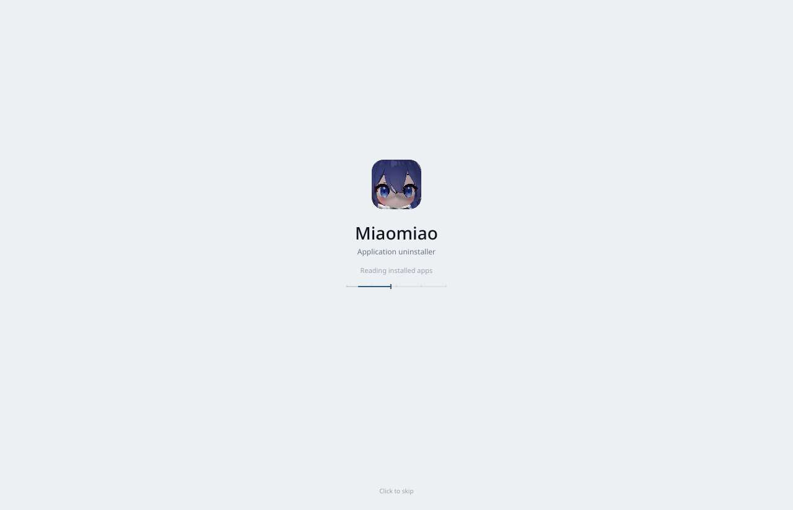
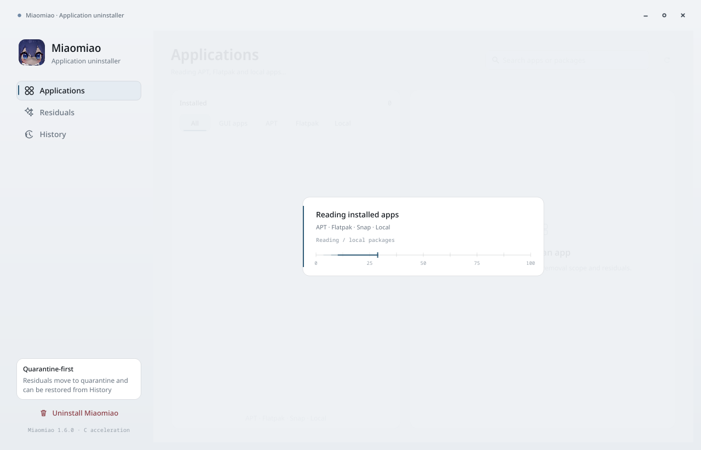
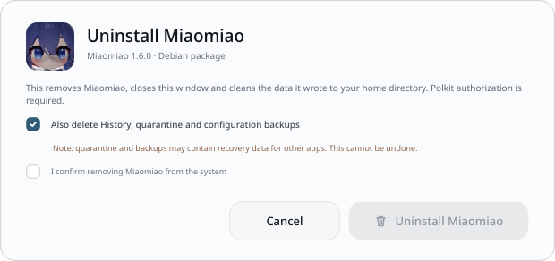

# Miaomiao 1.6.0

[简体中文](README.md) | English

A graphical application uninstaller and residual cleaner for Kali Linux 2026.3 and Debian-based systems. The interface is a cold instrument panel: flat surfaces, hairline rules, monospaced figures, no glass, glows or noise.

- Source: Python + PyQt6 + C11
- Package: `dist/miaomiao_1.6.0_amd64.deb`
- License: MIT








## Features

- Scans APT, Flatpak, Snap, local applications and AppImages into one list
- Shows real disk usage, residual size and protected shared directories
- Checks reverse dependencies, running processes and system protection before removal
- Residuals can be quarantined or permanently deleted; quarantined files can be restored from history
- Can uninstall Miaomiao itself, including user data, menu entries and desktop files
- Native C accelerator for directory sizing; Python owns every deletion decision and authorization check
- No network requests, telemetry or accounts
- The interface follows the system language: Chinese or English

## Language

The application reads the system locale in this order:

```text
LC_ALL → LC_MESSAGES → LANG
```

- values starting with `zh`: Chinese UI
- any other value or unset: English UI
- explicit override:

```bash
MIAOMIAO_LANG=zh miaomiao
MIAOMIAO_LANG=en miaomiao
```

Language is selected at launch. Restart the app after changing it. The Chinese sidebar is more compact; the English UI widens the sidebar, search field and action buttons so labels are not clipped.

## Technology

| Layer | Technology |
| --- | --- |
| Language | Python 3.11+ (developed on 3.14), C11 |
| UI | PyQt6 / Qt 6, custom QPainter widgets |
| Motion | QPropertyAnimation, QElapsedTimer, QGraphicsOpacityEffect |
| Native | `native/core.c` compiled to `libmiaomiao.so`, loaded through `ctypes` |
| Package managers | `dpkg-query`, `apt-get`, `flatpak`, `snap` |
| Privilege | Polkit / `pkexec`; user-directory operations need no root |
| Desktop | XDG Base Directory, desktop entry, hicolor icons, desktop-file-utils |
| Data | JSON history, quarantine files, backup directory |
| Packaging | Debian binary package, `dpkg-deb`, `debian/` maintainer scripts |

### Native C library

`native/core.c` provides:

- `mm_dir_size()`: recursive directory size
- `mm_paths_size()`: batch path sizing
- `mm_cancel()` / `mm_clear_cancel()`: cancel an in-flight scan

The library only reads the filesystem. It never deletes files. `glass_uninstaller/native.py` binds it with `ctypes`; Python fallback is used when the library is absent.

### Data and privileges

- Data directory: `~/.local/share/miaomiao`
- Quarantine: `~/.local/share/miaomiao/quarantine`
- History: JSON, capped at 100 records
- Legacy `~/.local/share/liquid-uninstaller` is migrated on first launch
- System package removal uses `pkexec apt-get purge`, `flatpak uninstall` or `snap remove`
- Shared directories, system paths and cross-application configuration are excluded by default

## Install

### From the bundled package

```bash
sudo dpkg -i dist/miaomiao_1.6.0_amd64.deb
```

If `_apt` cannot read a deb under `/home` because of mode 700:

```bash
cp dist/miaomiao_1.6.0_amd64.deb /tmp/
sudo apt install /tmp/miaomiao_1.6.0_amd64.deb
```

Run:

```bash
miaomiao
```

The Debian package name is `liquid-uninstaller`; the application, menu entry and command are `miaomiao`. The package name is kept for in-place upgrades from 1.1.x to 1.6.0. Seeing `liquid-uninstaller` in `apt` is expected.

### From source

```bash
sudo apt install python3-pyqt6 gcc make
./run.sh
```

`run.sh` compiles `libmiaomiao.so` when it is missing, then starts `app.py`.

## Build the Debian package

Dependencies:

```bash
sudo apt install python3-pyqt6 gcc make dpkg-dev
```

Build:

```bash
make native
./build-deb.sh
```

Output:

```text
dist/miaomiao_1.6.0_amd64.deb
```

`./build-deb.sh` compiles the C library itself, so `make native` is optional.

### Packaging details

`build-deb.sh`:

1. Reads the version from `glass_uninstaller/__init__.py`
2. Creates a temporary `.build/pkg` tree
3. Copies `app.py`, `glass_uninstaller/` and icons
4. Compiles `libmiaomiao.so` with `cc -O3 -std=c11 -shared`
5. Installs `/usr/bin/miaomiao`, the desktop file and three hicolor icon sizes
6. Copies README files, screenshots, copyright and Debian changelog
7. Computes `Installed-Size` and writes `md5sums`
8. Builds the package with `dpkg-deb --build --root-owner-group`
9. Removes `.build`

Package layout:

```text
DEBIAN/
  control
  postinst
  postrm
  md5sums
usr/bin/miaomiao
usr/lib/miaomiao/
  app.py
  glass_uninstaller/
  assets/icon-256.png
  libmiaomiao.so
usr/share/applications/miaomiao.desktop
usr/share/icons/hicolor/{128x128,256x256,512x512}/apps/miaomiao.png
usr/share/doc/liquid-uninstaller/
  README.md
  README.en.md
  LICENSE
  copyright
  changelog.Debian.gz
  *.png
```

Key `debian/control` fields:

- `Package: liquid-uninstaller`
- `Version: 1.6.0`
- `Architecture: amd64`
- `Depends: python3, python3-pyqt6, pkexec, desktop-file-utils, hicolor-icon-theme, libc6`
- `Suggests: flatpak, snapd`

`postinst` refreshes desktop and icon caches; `postrm` refreshes them on removal. The in-app self-uninstall also removes user data, menu entries and desktop files.

## Motion

One `OutCubic` curve; motion only explains state:

- Sidebar accent rail: 220 ms; filter underline: 220 ms
- Page crossfade: 160 ms; detail crossfade: 150 ms
- Button press scales to 0.98; search focus: 140 ms
- Filter, switch, checkbox: 120–150 ms; toast: 150 ms
- Footprint reveal: 320 ms; uninstall progress arc: 260 ms
- Loading uses a 16 ms instrument scan track with a time-driven playhead
- Window close is immediate; there is no exit animation

## Layout

```text
.
├── app.py
├── run.sh
├── Makefile
├── build-deb.sh
├── README.md
├── README.en.md
├── LICENSE
├── .gitignore
├── glass_uninstaller/
│   ├── backend.py      # scanning, plans, removal, quarantine, history
│   ├── native.py       # ctypes bindings
│   ├── i18n.py         # locale detection and bilingual strings
│   ├── theme.py        # palette, type, icons, surfaces
│   ├── widgets.py      # rows, filters, switches, ruler, loading
│   ├── pages.py        # applications, residuals, history
│   ├── dialogs.py      # confirmation, cleanup, self-uninstall, log
│   └── window.py       # window, scan scheduling, navigation
├── native/core.c       # native sizing and cancellation
├── assets/             # application icon
├── packaging/          # launcher, desktop file, icons
├── debian/             # control, postinst, postrm, copyright
├── dist/
│   ├── miaomiao_1.6.0_amd64.deb
│   └── SHA256SUMS
└── *.png               # README screenshots
```

## Verification

```bash
python3 -m py_compile app.py glass_uninstaller/*.py
desktop-file-validate packaging/miaomiao.desktop
dpkg-deb --info dist/miaomiao_1.6.0_amd64.deb
dpkg-deb --contents dist/miaomiao_1.6.0_amd64.deb
(cd dist && sha256sum -c SHA256SUMS)
```

## Supported systems

### Verified

| System | Version | Architecture | Desktop |
| --- | --- | --- | --- |
| Kali Linux | 2026.3 | amd64 | KDE Plasma 6 / X11 |

### Compatibility

| System | Version | Architecture | Status |
| --- | --- | --- | --- |
| Debian | 13 trixie | amd64 | Dependency-compatible; upstream of Kali 2026.3 |
| Debian | 12 bookworm | amd64 | Runs when dependencies are met; not fully regressed |
| Ubuntu | 24.04 LTS | amd64 | Runs when dependencies are met; not fully regressed |
| Kali Linux | 2026.x | amd64 | Same dependencies as 2026.3 |

### Requirements

- Debian-based distribution with `apt` / `dpkg`
- Python 3.11 or newer
- PyQt6 / Qt 6
- glibc 2.34 or newer
- X11 recommended; Wayland window move/resize depends on the compositor and is not fully verified
- Package is `amd64` only; no arm64, i386 or non-Linux build
- Flatpak and Snap are optional; only installed sources are listed
- GNOME and XFCE are not fully regressed

## Security model

1. Scan dependencies, running processes and protected paths before removal
2. Default mode is quarantine: files move to `~/.local/share/miaomiao/quarantine`
3. Permanent deletion must be selected explicitly
4. Shared directories, system paths and cross-application configuration are excluded
5. The C library only sizes directories; it never deletes files
6. System package removal uses Polkit; user-directory removal needs no root

## License

MIT. See [LICENSE](LICENSE).

## Credits

- Application icon provided by the project owner
- Visual direction follows the unslop method by Damir Sokolovsky (@heydamir), CC BY 4.0

## Publish to GitHub

The repository already contains `README.md`, `README.en.md`, `LICENSE`, `.gitignore`, source and the package under `dist/`. Add the remote and push:

```bash
git remote add origin git@github.com:<your-name>/miaomiao-uninstaller.git
git push -u origin main
```

For a GitHub Release, attach `dist/miaomiao_1.6.0_amd64.deb` and `dist/SHA256SUMS`.
