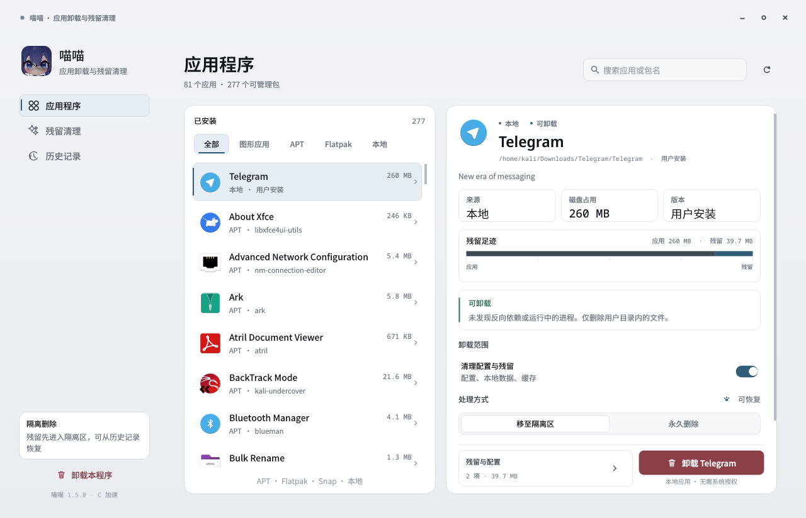
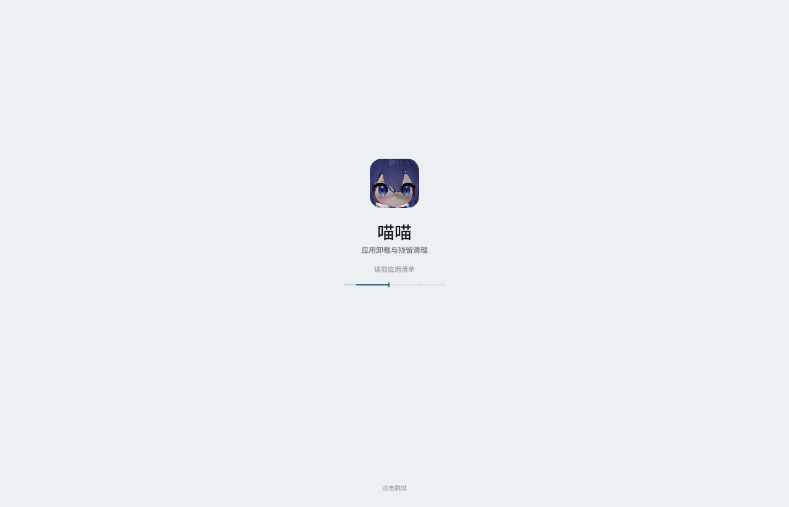
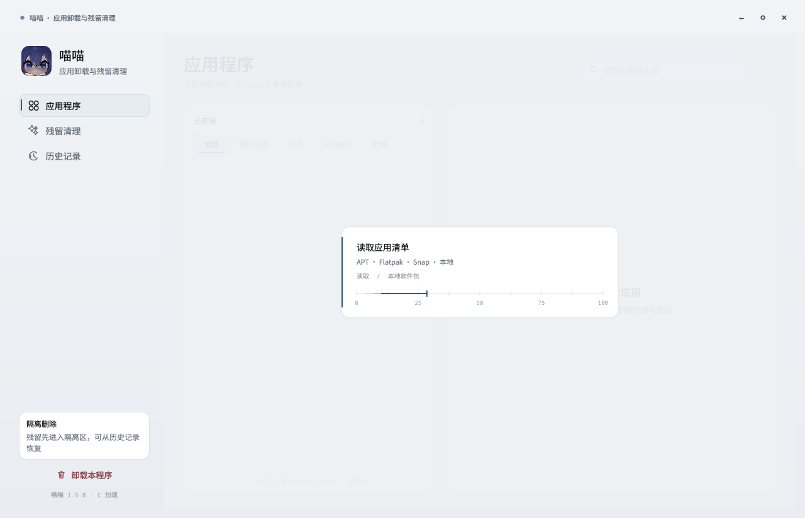
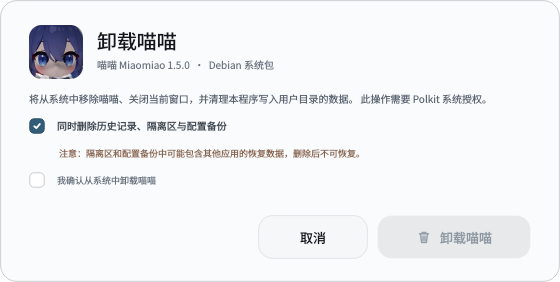

# 喵喵 1.5.0

简体中文 | [English](README.en.md)

Kali Linux 2026.3 及 Debian 系发行版的图形化应用卸载与残留清理工具。界面采用冷灰仪器面板：平直表面、发丝线、等宽数字，无玻璃、光斑或噪点。

- 源码：Python + PyQt6 + C11
- 安装包：`dist/miaomiao_1.5.0_amd64.deb`
- 许可证：MIT









## 功能

- 扫描 APT、Flatpak、Snap、本地应用和 AppImage，统一列表
- 选择应用后显示真实磁盘占用、残留大小和共享目录保护数量
- 卸载前检查反向依赖、运行进程和系统保护
- 残留可选隔离区或永久删除；隔离内容可从历史记录恢复
- 支持应用内卸载喵喵自身，并清理数据、菜单和桌面入口
- C 加速目录大小计算，Python 负责全部删除决策与权限校验
- 无网络请求、无遥测、无账户体系

## 技术栈

| 层 | 技术 |
| --- | --- |
| 语言 | Python 3.11+（开发环境 3.14）、C11 |
| UI | PyQt6 / Qt 6，QPainter 自绘控件 |
| 动效 | QPropertyAnimation、QElapsedTimer、QGraphicsOpacityEffect |
| 原生加速 | `native/core.c` 编译为 `libmiaomiao.so`，通过 `ctypes` 调用 |
| 系统包管理 | `dpkg-query`、`apt-get`、`flatpak`、`snap` |
| 权限 | Polkit / `pkexec`；用户目录操作不需要 root |
| 桌面集成 | XDG Base Directory、desktop entry、hicolor 图标、desktop-file-utils |
| 数据 | JSON 历史记录、隔离区文件、备份目录 |
| 打包 | Debian binary package、`dpkg-deb`、`debian/` 控制脚本 |

### 原生 C 部分

`native/core.c` 提供：

- `mm_dir_size()`：递归计算目录大小
- `mm_paths_size()`：批量计算路径大小
- `mm_cancel()` / `mm_clear_cancel()`：取消正在进行的扫描

原生库只读文件系统，不执行删除。`glass_uninstaller/native.py` 用 `ctypes` 绑定；库不存在时自动回退纯 Python 实现。

### 数据与权限

- 数据目录：`~/.local/share/miaomiao`
- 隔离区：`~/.local/share/miaomiao/quarantine`
- 历史记录：JSON，最多保留 100 条
- 旧路径 `~/.local/share/liquid-uninstaller` 首次启动自动迁移
- 系统包卸载通过 `pkexec apt-get purge`、`flatpak uninstall` 或 `snap remove`
- 共享目录、系统路径、跨应用配置默认排除

## 安装

### 使用仓库中的安装包

```bash
sudo dpkg -i dist/miaomiao_1.5.0_amd64.deb
```

如果 `_apt` 无法读取 `/home` 下的 deb（家目录权限 700 时常见）：

```bash
cp dist/miaomiao_1.5.0_amd64.deb /tmp/
sudo apt install /tmp/miaomiao_1.5.0_amd64.deb
```

安装后：

```bash
miaomiao
```

Debian 内部包名是 `liquid-uninstaller`，程序名、菜单名和命令是 `miaomiao` / 喵喵。保留内部包名是为了让 1.1.x 到 1.5.0 能原地升级；`apt` 显示 `liquid-uninstaller` 属于正常现象。

### 从源码运行

```bash
sudo apt install python3-pyqt6 gcc make
./run.sh
```

`run.sh` 会在缺少 `libmiaomiao.so` 时自动编译 C 库，然后启动 `app.py`。

## 构建 Debian 包

依赖：

```bash
sudo apt install python3-pyqt6 gcc make dpkg-dev
```

构建：

```bash
make native
./build-deb.sh
```

产物：

```text
dist/miaomiao_1.5.0_amd64.deb
```

也可以直接运行 `./build-deb.sh`：脚本会自行编译 C 库，不要求先执行 `make native`。

### 打包方式

`build-deb.sh` 执行以下步骤：

1. 从 `glass_uninstaller/__init__.py` 读取版本号
2. 建立 `.build/pkg` 临时树
3. 复制 `app.py`、`glass_uninstaller/` 和图标
4. 用 `cc -O3 -std=c11 -shared` 编译 `libmiaomiao.so`
5. 写入 `/usr/bin/miaomiao`、desktop 文件和三档 hicolor 图标
6. 复制 README、截图、copyright 和 Debian changelog
7. 计算 `Installed-Size`、写入 `md5sums`
8. 调用 `dpkg-deb --build --root-owner-group` 生成安装包
9. 删除 `.build`

包结构：

```text
DEBIAN/
  control
  postinst
  postrm
  md5sums
usr/bin/miaomiao
usr/lib/miaomiao/
  app.py
  glass_uninstaller/
  assets/icon-256.png
  libmiaomiao.so
usr/share/applications/miaomiao.desktop
usr/share/icons/hicolor/{128x128,256x256,512x512}/apps/miaomiao.png
usr/share/doc/liquid-uninstaller/
  README.md
  LICENSE
  copyright
  changelog.Debian.gz
  *.png
```

`debian/control` 关键字段：

- `Package: liquid-uninstaller`
- `Version: 1.5.0`
- `Architecture: amd64`
- `Depends: python3, python3-pyqt6, pkexec, desktop-file-utils, hicolor-icon-theme, libc6`
- `Suggests: flatpak, snapd`

`postinst` 刷新 desktop 与图标缓存；`postrm` 在卸载时刷新缓存。程序自身卸载时会额外清理数据目录、菜单项和桌面入口。

## 动效

统一使用 `OutCubic`，只做解释状态的反馈：

- 侧栏强调轨 220ms 滑动；筛选下划线 220ms 滑动
- 页面切换 160ms 淡入；应用详情 150ms 淡入
- 按钮按下缩放至 0.98；搜索框 140ms 焦点过渡
- 筛选、开关、复选框 120-150ms；Toast 150ms 淡入
- 残留足迹 320ms 展开；卸载进度弧 260ms 补间
- 加载界面使用 16ms 定时的仪器扫描轨，时间驱动
- 关闭窗口立即执行，无退出动画

## 目录

```text
.
├── app.py
├── run.sh
├── Makefile
├── build-deb.sh
├── README.md
├── README.en.md
├── LICENSE
├── .gitignore
├── glass_uninstaller/
│   ├── backend.py      # 扫描、计划、卸载、隔离、历史
│   ├── native.py       # C 库 ctypes 绑定
│   ├── theme.py        # 配色、字体、图标、表面
│   ├── widgets.py      # 行、筛选、开关、标尺、加载
│   ├── pages.py        # 应用、残留、历史页面
│   ├── dialogs.py      # 确认、清理、自卸载、日志
│   └── window.py       # 窗口、扫描调度、页面导航
├── native/core.c       # 目录大小加速与取消
├── assets/             # 应用图标
├── packaging/          # 启动脚本、desktop、图标
├── debian/             # control、postinst、postrm、copyright
├── dist/
│   ├── miaomiao_1.5.0_amd64.deb
│   └── SHA256SUMS
└── *.png               # README 截图
```

## 验证

```bash
python3 -m py_compile app.py glass_uninstaller/*.py
desktop-file-validate packaging/miaomiao.desktop
dpkg-deb --info dist/miaomiao_1.5.0_amd64.deb
dpkg-deb --contents dist/miaomiao_1.5.0_amd64.deb
(cd dist && sha256sum -c SHA256SUMS)
```

## 支持的系统

### 已验证

| 系统 | 版本 | 架构 | 桌面 |
| --- | --- | --- | --- |
| Kali Linux | 2026.3 | amd64 | KDE Plasma 6 / X11 |

### 兼容范围

| 系统 | 版本 | 架构 | 状态 |
| --- | --- | --- | --- |
| Debian | 13 trixie | amd64 | 依赖兼容；Kali 2026.3 的上游 |
| Debian | 12 bookworm | amd64 | 满足依赖时可运行；未完整回归 |
| Ubuntu | 24.04 LTS | amd64 | 满足依赖时可运行；未完整回归 |
| Kali Linux | 2026.x | amd64 | 同 2026.3 依赖 |

### 运行要求

- Debian 系发行版，`apt` / `dpkg` 可用
- Python 3.11 或更新版本
- PyQt6 / Qt 6
- glibc 2.34 或更新版本
- 推荐 X11；Wayland 下窗口拖动/缩放由桌面合成器决定，未完整验证
- 安装包仅提供 `amd64`，不提供 arm64、i386 或非 Linux 平台
- Flatpak、Snap 为可选依赖；未安装时只显示已存在的来源
- GNOME、XFCE 等 Qt 可运行的桌面环境未做完整回归

## 安全模型

1. 卸载前先扫描依赖、运行进程和受保护路径
2. 默认模式为隔离区，文件移动到 `~/.local/share/miaomiao/quarantine`
3. 永久删除必须显式选择
4. 共享目录、系统路径和跨应用配置默认排除
5. C 库只读取目录大小，不执行任何删除
6. 系统包卸载通过 Polkit 获取授权；用户目录删除不需要 root

## 许可证

MIT。完整文本见 [LICENSE](LICENSE)。

## 致谢

- 应用图标由项目所有者提供
- 视觉方向使用 unslop 方法，作者 Damir Sokolovsky（@heydamir），CC BY 4.0

## 发布到 GitHub

仓库已准备好 `README.md`、`LICENSE`、`.gitignore`、源码和 `dist/` 安装包。添加远程后推送即可：

```bash
git remote add origin git@github.com:<your-name>/miaomiao-uninstaller.git
git push -u origin main
```

发布 Release 时建议同时上传 `dist/miaomiao_1.5.0_amd64.deb` 和 `dist/SHA256SUMS`。
